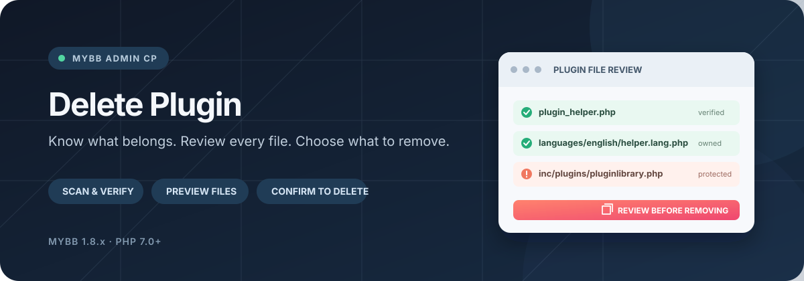

# Delete Plugin for MyBB

An Admin CP helper that removes a MyBB plugin together with the files that actually belong to it. Instead of asking you to delete a folder by hand, it scans the forum, shows every file it believes belongs to the plugin, explains why, and deletes only the rows you tick.

<p align="center">
  
</p>

- **Version:** 1.0.0
- **Codename:** `delete_plugin`
- **Compatibility:** MyBB 1.8.x (`18*`)
- **Author:** PARAD0X — [MyBB profile](https://community.mybb.com/user-134311.html)
- **License:** GPL-3.0

The plugin is entirely Admin CP side. It adds no front-end output, no database tables and no core file or template edits.

## What it does

The plugin manager gets a **Delete** link next to the Activate / Deactivate links. The link opens a scan page that:

1. Resolves the plugin's own folder(s) under `inc/plugins/`.
2. Parses the plugin source and follows every `require`, `include`, path string and glob it can resolve.
3. Sweeps `inc/plugins/` and the language folders for files named after the plugin whose content really references it.
4. Optionally sweeps the forum root for entry scripts such as `sw.js` or `store.php`.
5. Lists the accepted files with a reason and a size, and lists the rejected files with the reason they are kept.

Nothing is removed until the confirmation box is ticked and the form is submitted.

## Requirements

- MyBB 1.8.x.
- PHP 7.0 or newer (the scanner uses `Throwable`).
- [PluginLibrary](https://community.mybb.com/thread-92585.html) 13, bundled in this repository as `inc/plugins/pluginlibrary.php`. It is used for the settings group, the template set and the stylesheet cache entry.

## Installation

1. Copy the contents of this repository over your forum root, keeping the folder structure.
2. Make sure `inc/plugins/pluginlibrary.php` exists. It is included here, so a normal copy is enough.
3. Go to **Admin CP → Configuration → Plugins**, find **Delete Plugin** and click **Install**, then **Activate**.
4. The plugin appears under **Configuration → Delete Plugin** and adds a **Delete** link to every plugin row.

The installer writes a zero-byte marker at `inc/plugins/DeletePlugin/.installed`. That file is a runtime artifact and is deliberately **not** shipped in this repository: if it were present, a fresh copy would report itself as already installed.

## Using the scan page

Open **Configuration → Plugins** and click **Delete** on the plugin you want to remove. The scan page shows:

- the plugin name, version and codename;
- the folders the scanner treats as owned by the plugin;
- every file it will delete, pre-ticked, with the acceptance reason and size;
- every file it refuses to delete, with the reason (when *Show Protected Files* is on);
- the count of files per category (plugin code, language files, assets, data, dependencies).

At the bottom:

- **I have read the file list…** — required confirmation.
- **Run the plugin uninstall routine first** — calls `<codename>_uninstall()`.
- **Remove the plugin template groups and settings groups** — through PluginLibrary.
- **Remove the plugin folders once they are empty** — recursive empty-folder pruning.

The last three are pre-ticked by default, and every file row starts ticked.

### Order of operations

When the form is submitted, the plugin runs the steps in this order:

1. Re-run the scan. The posted paths are intersected with the fresh scan, so a forged request can only remove files the scanner already accepted.
2. Rebuild the plugin cache and deactivate the plugin if it is active, **before** any file is unlinked.
3. Run the target plugin's uninstall routine (optional), while its files still exist.
4. Unlink the selected files.
5. Prune empty folders inside the owned folders (optional).
6. Delete the template groups and settings groups through PluginLibrary (optional).
7. Delete the plugin's row from the `plugins` table.

## How the scanner decides

The scanner never trusts a filename alone. A file is accepted for one of these reasons:

| Reason | Meaning |
| --- | --- |
| `entry` | `inc/plugins/<codename>.php` itself. Always listed. |
| `owned` | The file sits inside a folder the scanner mapped to the plugin. |
| `referenced` | A folder the plugin code points at, and which the folder guard accepts. |
| `verified` | The filename carries the codename as a token and the content mentions the plugin. |
| `explicit` | Listed by the plugin through `delete_plugin_extra_files_<codename>()`, or through the *Extra Paths To Delete* setting. |
| `root_entry` | A root-level `.php` / `.js` file that references the plugin folder or namespace and passes the name check. |

The scan mode changes the reach:

- **Balanced** (default) — owned folders, referenced files, plus name-matched files whose content confirms the match.
- **Strict** — owned folders and files the plugin code actually loads. The name sweep is skipped.

### What is always kept

- MyBB core paths (`global.php`, `inc/class_*.php`, `inc/functions*.php`, `admin/inc/`, `jscripts/`, `install/`, …).
- `inc/plugins/pluginlibrary.php`, so shared PluginLibrary installs survive.
- Any path matching *Protected Paths* (`uploads`, `.git`, `node_modules`, `admin/backups`, …).
- Symbolic links, paths that resolve outside the forum root, and non-files.
- Anything in another plugin's folder under `inc/plugins/`.
- The Delete Plugin itself: `inc/plugins/delete_plugin.php` and `inc/plugins/DeletePlugin/`.

## Settings

Nine settings are registered in the `delete_plugin` group through `settings.json`:

| Setting | Default | Purpose |
| --- | --- | --- |
| Scan Mode | Balanced | Balanced (ownership + verified names) or Strict (ownership + loaded files). |
| Protected Paths | `inc/plugins/temp`, `Backup Plugins`, `admin/backups`, `uploads`, `.git`, `node_modules` | One path per line; folders protect their whole tree, wildcards allowed. |
| Extra Paths To Delete | empty | Paths outside the plugin folder that are always treated as part of the plugin. |
| Include Root Scripts | No | Sweep the forum root for entry scripts that reference the plugin. |
| Maximum File Size (KB) | 0 (no limit) | Skip files larger than this, except the plugin entry file. |
| Show Protected Files | Yes | Render the "files that stay on disk" table. |
| Run Uninstall By Default | Yes | Pre-tick the uninstall box. |
| Remove Templates And Settings By Default | Yes | Pre-tick the data-removal box. |
| Remove Empty Folders By Default | Yes | Pre-tick the folder-pruning box. |

## Admin permissions

The plugin registers three permissions on the Configuration permissions screen:

| Permission | Label | Enforced? |
| --- | --- | --- |
| `config/delete` | Can delete plugins? | Yes — the scan page and the delete request both require it. |
| `config/delete_link` | Can see the "Delete" link in the plugin list? | Yes — controls whether the JavaScript inserts the link. |
| `config/delete_plugin` | Can use the Delete Plugin scan page? | **No** — the key is declared and labelled but never checked. |

Super admins bypass every check.

## Hooks

| Hook | Function | Purpose |
| --- | --- | --- |
| `admin_config_plugins_begin` | `delete_plugin_admin_action` | Handles the `do_delete` request. |
| `admin_config_plugins_plugin_list` | `delete_plugin_set_flag` | Flags that the plugin list is rendering. |
| `admin_page_output_footer` | `delete_plugin_admin_footer` | Prints the plugin-list config div and script tag. |
| `admin_config_permissions` | `delete_plugin_admin_permissions` | Adds the three permissions. |
| `admin_config_menu` | `delete_plugin_admin_menu` | Adds the Configuration sub-menu entry. |
| `admin_config_action_handler` | `delete_plugin_admin_action_handler` | Declares the `delete_plugin` config action. |
| `admin_load` | `delete_plugin_admin_load` | Routes the action to `Admin/preview.php`. |

## Repository layout

```
inc/
├── languages/
│   └── english/
│       ├── delete_plugin.lang.php
│       └── admin/
│           └── delete_plugin.lang.php
└── plugins/
    ├── delete_plugin.php
    ├── pluginlibrary.php
    └── DeletePlugin/
        ├── Admin/preview.php
        ├── Assets/delete_plugin.css
        ├── Assets/delete_plugin.js
        ├── Functions/admin_functions.php
        ├── Functions/delete_functions.php
        ├── Functions/display_functions.php
        ├── Functions/scan_functions.php
        ├── Templates/*.html          (6 templates)
        ├── install.php
        └── settings.json
```

No `admin/` or `jscripts/` files are shipped: the plugin only hooks into the ACP.

## Known defects and limitations

These are properties of the current source, documented rather than fixed.

### Scanner correctness

1. **The scanner executes the target plugin.** `delete_plugin_get_plugin_info()` does `require_once` on `inc/plugins/<codename>.php` so it can call `<codename>_info()`. Any top-level code in that plugin runs on the ACP page. A plugin that calls `exit` / `die`, redirects, or assumes front-end globals can abort or corrupt the scan. Only `Throwable` is caught; `exit` is not.
2. **All of `jscripts/` is treated as core.** `delete_plugin_is_core_path()` blocks the whole `jscripts/` tree, so plugin JavaScript placed there is never removable, even when the plugin owns it.
3. **The core list is incomplete.** `newthread.php`, `xmlhttp.php`, `polls.php`, `editpost.php`, `inc/settings.php` and several other root/core scripts are missing from `$core_files` / `$core_dirs`. They are only protected if another rule happens to match.
4. **Extra Paths bypass the folder guard.** Directories in *Extra Paths To Delete* are walked with `delete_plugin_walk()` instead of `delete_plugin_add_folder()`, so ownership and core checks are skipped where the files are accepted. The preview can therefore list core files that `delete_plugin_safe_file()` refuses to unlink later, which makes the reported deletion count differ from reality without warning.
5. **Root-level helpers in `inc/plugins/` are never found.** `delete_plugin_is_foreign_plugin_path()` rejects every path under `inc/plugins/` that is not inside an owned folder, and that check runs before name matching. A plugin shipped as `delete_plugin.php` plus `delete_plugin_helper.php` will never have the helper scanned, because `delete_plugin.php` is a file, not a folder.
6. **Owned folders are claimed by slug suffix.** `delete_plugin_folder_slug_matches()` accepts a folder whose slug is a suffix of the codename slug. A plugin with codename `foo_market` claims `inc/plugins/Market` and every file inside it. Slugs shorter than three characters are ignored, and any folder anywhere under `inc/plugins/` (one level deep) can match.
7. **Content reads are capped.** Reference scanning stops at 256 KB per file, and template/settings prefix detection at 128 KB. A large PHP file with includes after that limit is not followed.
8. **PluginLibrary and external dependencies can never be removed.** `include_pluginlibrary` and `include_external_dependencies` default to `0` and are forced back to `0` in `delete_plugin_get_settings()`. They are not exposed in `settings.json`, so there is no UI to change them. A plugin's bundled dependency stays on disk by design.

### Safety and UX

9. **Destructive defaults.** Every file checkbox is rendered `checked`, the select-all box is checked, and uninstall / data removal / folder pruning are pre-ticked. Ticking the confirmation box and submitting removes everything the scan found.
10. **Uninstall runs before file deletion.** This is required because uninstall routines usually need their own files, but it means a fatal error or timeout inside the target uninstall aborts the request before any file is removed while the cache has already been deactivated.
11. **Deletion errors do not stop the chain.** `delete_plugin_remove_files()` collects unlink failures, yet the plugin still prunes folders, deletes its template and settings groups and removes its `plugins` row. Files can remain while the data and install state are gone, leaving an orphaned plugin folder and a plugin entry that reappears in the list with no database row.
12. **GET requests can delete.** The `do_delete` handler is attached to `admin_config_plugins_begin`, verifies a post key, but never checks `$mybb->request_method === 'post'`. A crafted GET URL with a valid key triggers deletion. MyBB's own POST verification only applies to POST requests.
13. **`delete_link` is cosmetic.** The delete link is hidden without it, but the POST handler checks only `delete`, so a user who has `delete` but not `delete_link` can still submit a deletion by URL.
14. **`delete_plugin` permission is dead.** The permission and its label exist, but no code path tests it.
15. **Uninstalled plugins get no delete link.** The JavaScript only attaches to `action=activate` / `action=deactivate` links. An installed-but-inactive plugin gets no link at all, so the documented workflow only covers the active/inactive cases.
16. **The Configuration sub-menu entry is a dead end.** It links to `index.php?module=config-delete_plugin` with no `plugin` argument, so `preview.php` immediately errors with "No plugin was specified for deletion" and redirects back.

### ACP integration

17. **Missing route file is fatal.** `delete_plugin_admin_load()` returns when `Admin/preview.php` is absent; MyBB then tries to include `admin/modules/config/delete_plugin.php`, which does not exist. The action handler also declares `delete_plugin.php` as the action file even though the plugin always intercepts the request.
18. **CSS and JS are printed as raw tags after the ACP header**, bypassing the template-only asset rule used elsewhere in this project. The CSS is additionally registered in the PluginLibrary stylesheet cache with `admin/*`, which the Admin CP does not read, so the file is registered and also hard-linked — effectively duplicated configuration.
19. **Language file reload per row.** `delete_plugin_reason_label()` and `delete_plugin_skip_label()` call `$lang->load('delete_plugin')` on every invocation, which means one include attempt per rendered row.
20. **Template-edit cleanup depends on the target plugin.** Core template changes are only reverted if the target plugin's own `_deactivate()` calls `find_replace_templatesets()`. The Delete Plugin does not revert them itself.

### Counters and dead code

21. **Group counters lie.** `delete_plugin_remove_plugin_data()` increments the template and settings counters once per attempted prefix, whether PluginLibrary actually removed a group or not. The success message can report groups cleared that never existed.
22. **Dead selection code.** `delete_plugin_merge_selected()`, `delete_plugin_expand_selection()` and `delete_plugin_walk_selection()` are defined but never called, and the "files that stay on disk" table has no checkboxes. The advertised path for deliberately selecting a protected file has no UI.
23. **Obsolete compatibility shim.** `delete_plugin_scan_plugin_files()` is a wrapper kept for backwards compatibility and is not used by the plugin itself.
24. **Install state is a file, not a database fact.** `delete_plugin_is_installed()` returns true whenever the zero-byte marker exists. Copying the folder without running the installer makes MyBB believe the plugin is installed and offers Uninstall instead of Install.

## Compatibility notes

- The plugin targets MyBB 1.8.x only. It relies on `admin_config_plugins_plugin_list`, `admin_config_permissions` and the `admin_load` routing order present in 1.8.
- The scan page assumes the Admin CP is served from the same host as `bburl`, because the CSS and JS URLs are built from `$mybb->settings['bburl']`.
- PluginLibrary 13 is bundled unmodified. Its own header declares the GNU Lesser General Public License v3.0; this repository's GPL-3.0 license covers the Delete Plugin code only.

## License

GPL-3.0. See [LICENSE](LICENSE).
